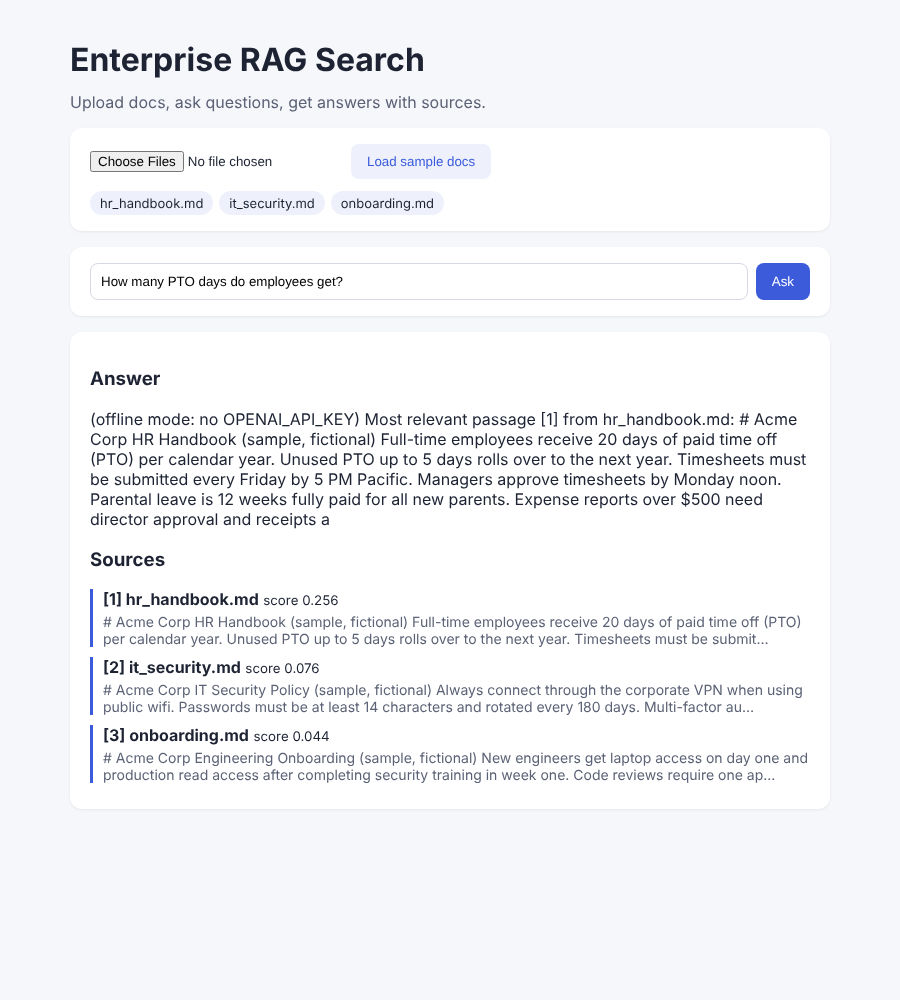
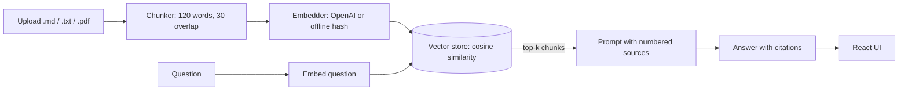

# Enterprise RAG Search

Upload documents, ask questions in plain English, and get answers with citations back to the source text.

I built this to understand each part of a retrieval-augmented generation (RAG) pipeline end to end: chunking, embeddings, vector search, and grounded prompting.



**Stack:** Python, Flask, NumPy, OpenAI API, React (Vite), Docker, pytest, GitHub Actions

Note: the sample documents are fictional.

## How it works



1. **Chunking.** Documents are split into overlapping word windows so text near a boundary isn't lost.
2. **Embedding.** Each chunk is converted to a vector with `text-embedding-3-small`.
3. **Retrieval.** The question is embedded and compared against all chunks by cosine similarity. The top 4 are returned.
4. **Generation.** The model is told to answer only from those sources and to cite them as `[1]`, `[2]`. If the answer isn't there, it says so.

## Design notes

- **Offline mode.** Without an API key, the app uses a hashed bag-of-words embedder and returns the best matching passage. This makes it easy to demo and test.
- **Simple vector store.** About 30 lines of NumPy. I kept it small on purpose so the retrieval logic is easy to follow. It can be replaced with pgvector or FAISS.
- **Citations.** Requiring numbered sources makes it easy to check whether an answer is actually supported.
- **Pluggable LLM.** `RAGPipeline(llm=...)` accepts any function, which keeps the pipeline unit-testable.

## Running locally

With Docker:

```bash
cp .env.example .env          # OPENAI_API_KEY is optional
docker compose up --build     # UI: http://localhost:5173, API: http://localhost:5000
```

Without Docker:

```bash
cd backend
pip install -r requirements.txt
flask --app app.main run

cd ../frontend
npm install
npm run dev
```

Open the UI, click **Load sample docs**, and try "How many PTO days do employees get?"

## API

| Method | Endpoint | Body | Returns |
|---|---|---|---|
| GET | `/api/health` | none | loaded documents |
| POST | `/api/upload` | multipart `files` | chunks added per file |
| POST | `/api/load-samples` | none | loads `sample_docs/` |
| POST | `/api/ask` | `{"question": "..."}` | `answer` and `citations` |

## Tests

```bash
cd backend && pytest -q
```

Tests cover chunk overlap, vector ranking, citation output, and the empty-store case. They run on every push through GitHub Actions.

## Project structure

```
backend/app/
  chunker.py        overlapping chunks
  embeddings.py     OpenAI and offline embedders
  vector_store.py   cosine similarity search
  rag.py            pipeline and prompt
  main.py           Flask API
frontend/src/App.jsx
sample_docs/        fictional HR, IT, and onboarding docs
```

## Possible improvements

- Replace the NumPy store with pgvector
- Hybrid search (BM25 plus vectors)
- Add a re-ranking step
- Stream answers to the UI

## Author

Pradeepreddy Annapareddy · [LinkedIn](https://linkedin.com/in/pradeepreddyar)
